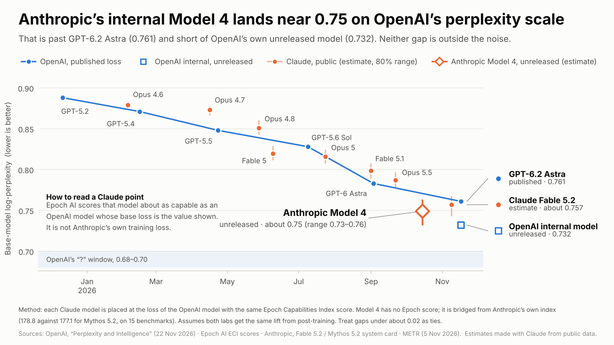

# Claude models on OpenAI's log-perplexity scale

Data, assumptions and code behind this chart:



On 22 November 2026 OpenAI published base-model log-perplexity for its models since GPT-3.5, measured on a fixed snapshot of its own codebase. This repo asks where Anthropic's models would sit on that axis, using Epoch AI's Capabilities Index (ECI) as the bridge.

**Every Claude number here is a capability-equivalent estimate. None is a measured loss for any Anthropic model.** A Claude point at 0.80 means: Epoch scores that model about as capable as an OpenAI model whose base loss is 0.80.

## Result

| Model | Status | On OpenAI's scale | 80% range |
|---|---|---|---|
| GPT-6.2 Astra | published by OpenAI | 0.761 | |
| Claude Fable 5.2 | estimate | 0.757 | 0.743–0.767 |
| Anthropic Model 4 | estimate, unreleased model | 0.749 | 0.732–0.762 |
| OpenAI internal model | published by OpenAI, unreleased model | 0.732 | |

Under the assumptions below, Model 4 is past GPT-6.2 Astra in 86% of draws and reaches OpenAI's internal model in 9%. Gaps under about 0.02 should be read as ties.

All ten estimates are in [`results/estimates.csv`](results/estimates.csv).

## Data

| File | Contents | Source | How it was read |
|---|---|---|---|
| [`data/openai_log_perplexity.csv`](data/openai_log_perplexity.csv) | 13 released models and one internal model: month, loss, capability line | OpenAI, [Perplexity and Intelligence](https://openai.com/index/perplexity-and-intelligence/) | From the chart's own data labels on the page, 22 Nov 2026. Values are as published, to three decimals. |
| [`data/epoch_eci_subset.csv`](data/epoch_eci_subset.csv) | ECI score, 95% interval and release date for the 28 OpenAI and Anthropic models used | Epoch AI, [`eci_scores.csv`](https://epoch.ai/data/eci_scores.csv) | Through an automated page fetch on 22 and 23 Nov 2026, not a direct download. The two reads agree on every row. |
| [`data/anthropic_aeci.csv`](data/anthropic_aeci.csv) | Anthropic's own index (AECI) for seven models, with global and local 95% intervals | Anthropic, [system card for Claude Fable 5.2 and Mythos 5.2](https://www.anthropic.com/document/claude-fable-5-2-mythos-5-2-system-card), Table 2.3.5.3.A (6 Nov fit) | Through an automated fetch of the PDF, read twice with the same result. |
| [`data/openai_product_to_base.csv`](data/openai_product_to_base.csv) | Which Epoch product is assigned to which point on OpenAI's chart | This repo | An assumption, not source data. See A2. |

Epoch updates ECI scores as new benchmark results arrive, so the live file may no longer match this snapshot. The `plot_date` column in the OpenAI file is where each point is drawn on the x-axis; OpenAI publishes only the month.

## Method

1. **Build OpenAI's curve.** Take the seven released OpenAI models from GPT-5/5.1 to GPT-6.2 Astra. Each has a published loss and an Epoch ECI score, which gives seven (ECI, loss) pairs. Over this stretch loss falls as ECI rises, with no reversals.
2. **Place each public Claude model.** Look up the model's ECI on that curve and read off the loss, interpolating linearly between points. Fable 5.2 scores 0.6 points above the curve's top end, so it is extrapolated (A3).
3. **Place Model 4.** It has no Epoch score. Anthropic's system card gives an "Internal Model" an AECI of 178.78 against 177.12 for Mythos 5.2. AECI is not on Epoch's scale, so it is calibrated on the five models that have both scores (AECI runs 3.7 to 6.1 points higher, slope 1.01). That puts Model 4 at about 174.5 in ECI terms, which is then read off the curve like any other model.
4. **Ranges.** 40,000 Monte Carlo draws per model vary the model's ECI, the curve's ECIs and the extrapolation slope. Ranges are the 10th to 90th percentile.

## Assumptions

| | Assumption | If it is wrong |
|---|---|---|
| A1 | Two models with the same ECI have equally good base models. This needs both labs to get the same lift from post-training, reasoning effort and scaffolding. | Any difference is misread as a difference in base loss. This is the largest source of error and it is **not** in the ranges. |
| A2 | Each point on OpenAI's chart is represented by its standard product: GPT-5.1 for "GPT-5 / 5.1", GPT-5.4 for "GPT-5.3-Codex / 5.4", and so on. Pro variants are left out. | A Pro variant reads about 0.02 lower than its own base model's published loss, so the choice of product matters at that scale. |
| A3 | Beyond the ends of the curve, capability rises 1.4 ECI points per 0.01 of loss (uniform 1.0 to 1.64 in the ranges). 1.0 is the slope from the all-product regression, 1.39 from Dec 2025 onward, 1.64 from the last segment. | Only affects Fable 5.2 and Model 4. Across the whole 1.0 to 1.64 span, Model 4 moves between 0.744 and 0.751. |
| A4 | The model-specific part of Epoch's uncertainty is half the published interval; the rest is scale uncertainty shared by all models, which cancels when comparing them. Anthropic's system card reports local intervals at 0.26 to 0.30 of global for its fork, so 0.5 is the cautious side. | At 1.0, Fable 5.2's range widens to 0.732–0.775 and Model 4's to 0.725–0.767. |
| A5 | The system card's "Internal Model" is the model METR calls Model 4. Neither source says so. The inference rests on both being scored on 15 benchmarks at near-identical values (178.78 and 178.6). | The label on the chart is wrong; the estimate still describes the system card's internal model. |
| A6 | AECI maps linearly to ECI, and a Mythos model's AECI can be paired with the matching Fable model's ECI (same underlying model, different safeguards). Two routes are used: Fable 5.2's ECI plus the AECI gap (175.1), and the calibration line (173.9). The point estimate is their mean; the ranges mix them uniformly. | The two routes differ by 1.2 ECI points, about 0.008 of loss. |
| A7 | Errors in Model 4's and Mythos 5.2's AECI are independent and normal, sized from their local intervals. | The range for Model 4 is too wide or too narrow. |
| A8 | No time adjustment. Dates only set positions on the x-axis. Model 4 is drawn at mid-October 2026, the month METR says it became available internally. | Horizontal position only. |

## Why A1 is shaky

These come straight from the data and are printed by the scripts.

- **Same base, different score.** GPT-5.5 Pro scores 2.6 ECI points above GPT-5.5 on the same base model; the Pro gaps for GPT-5.4 and GPT-5.2 are 2.4 and 2.8. Read through the curve, that is about 0.02 of "loss" from inference compute alone. o1 scored 13 points above GPT-4o on a shared base.
- **Different base, same score.** Opus 5 (164.7) matches Fable 5 (164.2), though Anthropic positions the Mythos class as a tier above Opus.
- **A known asymmetry.** The system card says training for Fable 5.2 and Mythos 5.2 held back capabilities that most directly speed up AI development.

## Known weaknesses

- **Circular by construction.** The chart is Epoch's leaderboard redrawn on OpenAI's axis. "Claude sits on OpenAI's curve" restates "Claude's ECI is close to OpenAI's".
- **Loss and time cannot be separated in 2026.** Across OpenAI's releases from Dec 2025 they correlate at −0.98. A pure time trend of 20 ECI points per year fits as well as a loss slope.
- **Nothing before Dec 2025 is usable.** OpenAI's published loss rises between GPT-4.5 and GPT-4.1/o3 while capability climbs, so an ECI score has no single matching loss there. Opus 4.5 is computed but not drawn, because it falls on a nearly flat stretch that makes its range look far tighter than it is.
- **Model 4 may be understated.** It was scored on 15 benchmarks and exceeds 50% on all of them, which METR flags as a measurement problem.
- **OpenAI's internal model has no capability score.** Comparing Model 4 with it relies on extending OpenAI's curve past its last released model.
- **A different dataset.** OpenAI's numbers are per-token loss on OpenAI's internal codebase. Nothing here says how a Claude model would score on that data.

## Regression check

[`src/regression_check.py`](src/regression_check.py) fits `ECI = a + b·loss + c·time + d·reasoning` on 16 OpenAI products as an alternative to curve matching. It is not used for the chart. It gives 1.00 ± 0.23 ECI points per 0.01 of loss, 8.7 points per year at fixed loss and 7.9 points for a reasoning model, with a residual of 0.025 in loss terms. Output is in [`results/regression_check.txt`](results/regression_check.txt).

## Reproduce

```
pip install -r requirements.txt
python src/estimate.py          # results/estimates.csv, estimates.json, diagnostics.txt
python src/regression_check.py  # results/regression_check.txt
python src/chart.py             # results/model4_on_openai_scale.png
```

The random seed is fixed, so the estimates reproduce exactly. The chart uses the Inter typeface if it is installed and falls back to DejaVu Sans.

## Sources and licences

- OpenAI, [Perplexity and Intelligence](https://openai.com/index/perplexity-and-intelligence/), 22 Nov 2026.
- Epoch AI, "Epoch Capabilities Index". Published online at epoch.ai. Retrieved from https://epoch.ai/eci, 23 Nov 2026. Epoch's data is reused under [CC BY 4.0](https://creativecommons.org/licenses/by/4.0/); the subset here is unmodified apart from dropping unused rows and columns.
- Anthropic, [System Card: Claude Fable 5.2 & Claude Mythos 5.2](https://www.anthropic.com/document/claude-fable-5-2-mythos-5-2-system-card), 9 Nov 2026.
- METR, [Independent Assessment of AI R&D Acceleration at Anthropic in October 2026](https://metr.org/blog/2026-11-05-anthropic-ai-rd-acceleration-assessment/), 5 Nov 2026.

Code is under the MIT licence. The data files compile figures from the sources above and remain theirs.

The analysis was prepared with Claude (Claude Fable 5.2) from public sources only. Claude has no inside information about Anthropic's or OpenAI's training runs.
